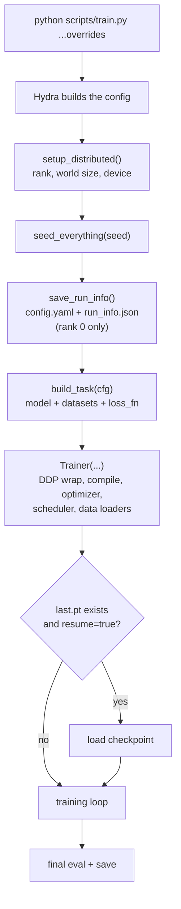
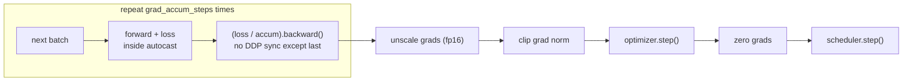

# 3. Training flow

This document follows one run from the command line to the last step.

## Overview



Code: [scripts/train.py](../scripts/train.py) → [trainer.py](../src/mltemplate/training/trainer.py).

## 1. Config and process setup

- Hydra composes `configs/train.yaml` with the overrides.
- `setup_distributed()` reads `RANK`, `LOCAL_RANK`, `WORLD_SIZE` (set by `torchrun`).
  Without them it is a single process. It picks `cuda:<local_rank>` if a GPU exists,
  otherwise CPU.
- Every rank uses the **same seed**, so all replicas start with identical weights.
- Only rank 0 writes files and logs.

## 2. The Task

The trainer is generic. Everything project-specific comes from a `Task`
([tasks/base.py](../src/mltemplate/tasks/base.py)):

```python
@dataclass
class Task:
    model: nn.Module
    train_dataset: Dataset  # items are dicts of tensors
    val_dataset: Dataset
    loss_fn: LossFn  # loss_fn(model, batch) -> (loss, {"metric": tensor})
```

Extra metrics returned by `loss_fn` (for example `accuracy`) are averaged and logged
automatically as `train/<name>` and `val/<name>`.

## 3. Trainer setup

In this order:

1. Move the model to the device and keep a reference to the **raw** model (used for saving,
   so checkpoint keys never get `module.` or `_orig_mod.` prefixes).
2. Wrap in `DistributedDataParallel` when there is more than one process.
3. Wrap in `torch.compile` if `train.compile=true`.
4. Build AdamW with two parameter groups: weight decay on matrices only, not on biases
   and normalization weights.
5. Build the warmup + cosine LR scheduler.
6. Build data loaders. A `DistributedSampler` is used **even with one process**: it gives
   a seeded shuffle per epoch, which is what makes exact resume possible.

## 4. One optimizer step



Details (`Trainer.train_step`):

| Part | What it does | Why |
|---|---|---|
| **Autocast** | Runs forward in `bf16`/`fp16` where safe | ~2× faster and less memory on modern GPUs |
| **GradScaler** | Only active for `fp16` | fp16 gradients can underflow; bf16 does not need it |
| **Loss / accum** | Each micro-batch contributes `1/accum` | Accumulated gradient equals the gradient of one big batch (tested) |
| **`no_sync()`** | Skips DDP all-reduce on all but the last micro-batch | Avoids useless communication |
| **Unscale before clip** | Brings fp16 gradients back to real scale | Clipping must see the true norm |
| **Grad clipping** | Caps total grad norm at `train.grad_clip` | Prevents loss spikes; the norm is logged either way |
| **Scheduler** | Linear warmup, then cosine to `lr × min_lr_ratio` | Standard recipe for transformers |

## 5. The loop

```
while step < max_steps:
    train_step()
    every log_every  steps -> log train metrics, samples/sec, lr, peak GPU memory
    every eval_every steps -> evaluate on val set; if best so far, save best.pt
    every save_every steps -> save last.pt
```

The final step always logs, evaluates and saves, whatever the intervals are.

`evaluate()` switches to `eval()` mode, runs the whole validation set without gradients,
averages loss and metrics, then averages again across GPUs with `all_reduce`.

## 6. Logged metrics

| Metric | Meaning |
|---|---|
| `train/loss`, `train/<metric>` | Averaged over the micro-batches of the step |
| `train/grad_norm` | Total gradient norm **before** clipping |
| `train/lr` | Current learning rate |
| `train/epoch` | Epochs completed |
| `perf/samples_per_sec` | Throughput across all GPUs since the previous log |
| `perf/peak_mem_gb` | Peak GPU memory (CUDA only) |
| `val/loss`, `val/<metric>` | Validation results |

## Precision guide

| GPU | Use |
|---|---|
| Ampere or newer (RTX 30xx/40xx, A100, A6000, L40S, H100) | `bf16` |
| Older (V100, T4, RTX 20xx) | `fp16` |
| CPU / debugging numerical issues | `fp32` |
