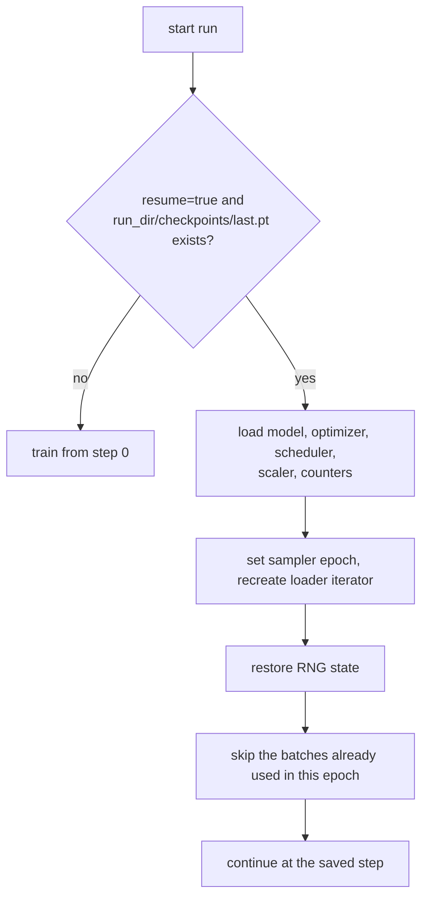

# 4. Checkpoint and resume

RunPod pods (especially spot/interruptible ones) can stop at any time. The template is built
so that a stopped run continues **exactly** where it left off: a run interrupted at step
10 and resumed produces bit-identical weights to a run that never stopped. A test checks this
(`tests/test_trainer.py::test_resume_is_exact`).

## What a checkpoint contains

Code: [checkpoint.py](../src/mltemplate/training/checkpoint.py), `Trainer.state_dict()`.

| Key | Why it is needed |
|---|---|
| `model` | Weights (from the raw model, no `module.` prefix) |
| `optimizer` | AdamW moments; without them training "restarts" and the loss jumps |
| `scheduler` | Position in the warmup/cosine schedule |
| `scaler` | fp16 loss scale |
| `step`, `epoch`, `batch_in_epoch` | Where to continue, including the position inside the epoch |
| `best_val_loss` | So `best.pt` is only replaced by a genuinely better model |
| `rng` | Python, NumPy, PyTorch CPU and CUDA random states (dropout, augmentation) |
| `config` | The resolved config, so a checkpoint can be evaluated or served on its own |

## Files

- `checkpoints/last.pt`: written every `save_every` steps and at the end. Used for resume.
- `checkpoints/best.pt`: written when validation loss improves. Use it for evaluation/serving.

Saving is **atomic**: the file is written to `last.pt.tmp` and then renamed. If the pod dies
mid-write, the previous `last.pt` is still intact.

Only rank 0 writes; the other ranks wait at a barrier so nobody runs ahead.

## Resume flow



How to resume: run **the same command again** (same `experiment_name` / `run_dir`).

```bash
python scripts/train.py experiment_name=gpt_125m       # stops at step 3,400
python scripts/train.py experiment_name=gpt_125m       # continues from 3,400
```

To start over instead, use a new `experiment_name`, delete the folder, or pass
`train.resume=false`.

## Two details that make resume exact

1. **Data order.** The sampler shuffles with `seed + epoch`, so epoch N always has the same
   order. On resume the trainer sets the saved epoch and skips `batch_in_epoch` batches.
   Skipping iterates the loader, so for huge datasets it costs some time; for token datasets
   (Phase 1) a faster option is to compute the offset into the memmap directly.
2. **RNG timing.** Creating a DataLoader iterator draws a random number. An uninterrupted run
   draws it at the start of the epoch, before the checkpoint was written. So the RNG state is
   restored **after** the iterator is created, not right after loading
   (`Trainer._batches`). Without this, dropout masks would differ after resume.

## Changing settings when resuming

Resuming uses the **current** config for everything except what is stored in the
checkpoint. It is fine to change logging/eval intervals. Changing `max_steps` changes the
cosine schedule's length, so the LR curve will bend; do that knowingly.

## Security note

Checkpoints are loaded with `torch.load(weights_only=False)` because they contain RNG and
optimizer objects. Only load checkpoints you created yourself.
