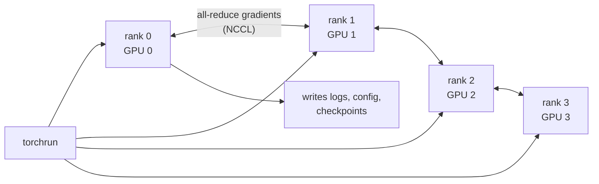

# 6. Distributed training (DDP)

The same `scripts/train.py` runs on 1 or many GPUs. Code:
[distributed.py](../src/mltemplate/training/distributed.py).

## Launching

```bash
# 1 GPU / CPU
python scripts/train.py experiment_name=single

# 4 GPUs on one machine (Linux, RunPod)
torchrun --standalone --nproc_per_node=4 scripts/train.py experiment_name=ddp4

# Windows (local testing on CPU), see "Windows" below
python scripts/spawn_ddp.py --nproc 2 experiment_name=ddp_local
```

## How it works



1. `torchrun` starts one process per GPU and sets `RANK`, `LOCAL_RANK`, `WORLD_SIZE`.
2. `setup_distributed()` binds each process to `cuda:<LOCAL_RANK>` and starts the process
   group: **NCCL** on GPU, **gloo** on CPU.
3. The model is wrapped in `DistributedDataParallel`. DDP copies rank 0's weights to all
   ranks, and after every backward pass it averages gradients across ranks.
4. `DistributedSampler` gives each rank a different slice of the data.
5. Validation metrics are averaged across ranks with `all_reduce_mean`.
6. Only rank 0 logs and saves. A barrier after saving keeps ranks in step.

## Batch size and learning rate

`train.batch_size` is **per GPU**. With 4 GPUs, `batch_size=32`, `grad_accum_steps=4`:

```
effective batch = 32 × 4 × 4 = 512 samples per optimizer step
```

To compare 1 vs 4 GPUs fairly (Phase 1 scaling table), keep the effective batch the same,
for example `grad_accum_steps=4` on 1 GPU vs `grad_accum_steps=1` on 4 GPUs.

## Measuring scaling efficiency

```
scaling efficiency = throughput(N GPUs) / (N × throughput(1 GPU))
```

Use the `perf/samples_per_sec` metric (already summed over all GPUs). Ignore the first log
interval: it includes start-up and `torch.compile` time.

## torch.compile + DDP

With `train.compile=true` the DDP-wrapped model is compiled. The first steps are slow while
kernels compile; this is normal.

## Windows

PyTorch's Windows builds do not include libuv, and `torchrun`'s rendezvous currently fails on
Windows because of it. `scripts/spawn_ddp.py` starts the processes with
`torch.multiprocessing` instead and sets `USE_LIBUV=0`. It is meant for checking DDP code
locally on CPU; real multi-GPU training happens on Linux (RunPod), where `torchrun` works
normally. A warning about `kubernetes.docker.internal` on Windows is harmless.

## Common problems

| Symptom | Cause / fix |
|---|---|
| Hangs at start | A rank crashed; check every rank's log. Set `NCCL_DEBUG=INFO` for details |
| Hangs during training | Ranks do different numbers of steps; keep `drop_last=True` (already set) |
| `Address already in use` | Another job uses the port; add `--master_port=29501` |
| Different results per rank | Data or randomness not seeded identically; check `seed_everything` runs first |
