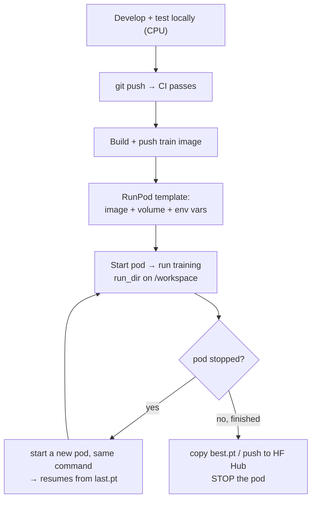

# 8. Docker and RunPod

## Images

| Image | File | Base | Use |
|---|---|---|---|
| Train | [docker/Dockerfile.train](../docker/Dockerfile.train) | `pytorch/pytorch` 2.7 (CUDA 12.8) | Training on RunPod GPU pods, including RTX 5090 (Blackwell) |
| Serve | [docker/Dockerfile.serve](../docker/Dockerfile.serve) | `python:3.12-slim` + CPU torch | Small inference API |

Build from the repository root:

```bash
docker build -f docker/Dockerfile.train -t <dockerhub-user>/mltemplate-train:0.1 .
docker build -f docker/Dockerfile.serve -t <dockerhub-user>/mltemplate-serve:0.1 .
docker push <dockerhub-user>/mltemplate-train:0.1
```

Use a version tag (`:0.1`), not only `latest`, so each experiment records which image it used.

### Choosing a GPU

| GPU | Notes |
|---|---|
| RTX 3090 / A4000 | Cheap; good for debugging, Tiny Shakespeare, YOLO |
| RTX 4090 (24 GB) | Best all-rounder; widest library support |
| RTX 5090 (32 GB) | Faster and more VRAM, but Blackwell: needs CUDA 12.8+ images and recent bitsandbytes / vLLM / TensorRT |

Compare cost per job, not price per hour: run ~100 steps on each candidate, read
`perf/samples_per_sec`, and compute `price_per_hour / samples_per_sec`. Lower is cheaper.
When renting a 5090, filter pods by CUDA version 12.8 or newer.

The train image puts code in **`/app`**, not `/workspace`: RunPod mounts the network volume at
`/workspace`, which would hide anything copied there.

## RunPod workflow



### One-time setup

1. **Network volume** (Storage → Network Volumes): create one in the region where your GPU
   type is available, e.g. 50–100 GB. It keeps datasets, checkpoints and the Hugging Face
   cache when pods are deleted.
2. **Template** (Templates → New):
   - Container image: `<dockerhub-user>/mltemplate-train:0.1`
   - Volume mount path: `/workspace`
   - Environment variables: `WANDB_API_KEY`, `HF_TOKEN` (use RunPod secrets)
   - Expose SSH / Jupyter if you want an interactive shell
3. **Pod**: deploy from the template with the network volume attached.

### Running training on a pod

```bash
cd /app
python scripts/train.py \
    experiment_name=gpt_125m \
    run_dir=/workspace/outputs/gpt_125m \
    tracking.backend=wandb tracking.project=indo-gpt

# multi-GPU pod
torchrun --standalone --nproc_per_node=4 scripts/train.py \
    experiment_name=gpt_125m_ddp4 run_dir=/workspace/outputs/gpt_125m_ddp4
```

Run long jobs inside `tmux` (or `nohup ... &`) so they survive an SSH disconnect.

If the pod stops (spot interruption, manual stop), start a new one with the same volume and
run **the same command**: training resumes from `/workspace/outputs/<name>/checkpoints/last.pt`.

### Iterating on code without rebuilding the image

During development, clone the repo onto the volume and install it on top of the image:

```bash
cd /workspace && git clone https://github.com/<user>/<project>.git && cd <project>
pip install -e . --no-deps
python scripts/train.py run_dir=/workspace/outputs/test
```

Rebuild the image when dependencies change.

## Budget rules

- **Stop pods when idle.** A forgotten pod is the most common way to lose money.
- Debug on CPU or a cheap GPU; move to big GPUs only for real runs.
- Prefer spot/interruptible pods for training: the template resumes exactly.
- Note the GPU model in every benchmark table (`run_info.json` records it).

## Serving image locally

```bash
docker run -p 8000:8000 \
    -v "$(pwd)/outputs/demo/checkpoints:/models" \
    -e CHECKPOINT_PATH=/models/best.pt \
    <dockerhub-user>/mltemplate-serve:0.1
```

See [09 Serving](09-serving.md).
