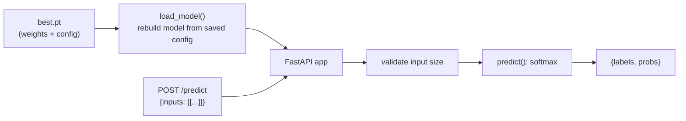

# 9. Serving

A trained checkpoint can be served as an HTTP API with FastAPI.
Code: [inference/predict.py](../src/mltemplate/inference/predict.py),
[app/serve.py](../app/serve.py).

## Flow



Because every checkpoint stores its config, the API does not need the `configs/` folder:
the checkpoint alone is enough to rebuild the model.

## Run locally

```bash
pip install -e ".[serve]"

# bash
CHECKPOINT_PATH=outputs/demo/checkpoints/best.pt uvicorn app.serve:app --port 8000
# PowerShell
$env:CHECKPOINT_PATH = "outputs/demo/checkpoints/best.pt"; uvicorn app.serve:app --port 8000
```

Interactive docs: <http://localhost:8000/docs>

## Endpoints

| Method | Path | Body | Response |
|---|---|---|---|
| GET | `/health` | none | `{"status": "ok", "checkpoint": "..."}` |
| POST | `/predict` | `{"inputs": [[float × in_dim], ...]}` | `{"labels": [int, ...], "probs": [[float, ...], ...]}` |

Example:

```bash
python -c "import json; print(json.dumps({'inputs': [[0.0]*32]}))" > req.json
curl -X POST localhost:8000/predict -H "Content-Type: application/json" -d @req.json
```

Wrong input sizes return HTTP 422 with an explanation.

## Docker

See [08 Docker and RunPod](08-docker-and-runpod.md#serving-image-locally).

## Adapting for later projects

| Project | Change |
|---|---|
| Phase 1 GPT | `/generate` endpoint: prompt, `max_new_tokens`, `temperature`, `top_k`, `top_p`; plus a Gradio UI on Hugging Face Spaces |
| Phase 2 summarizer | Merge LoRA weights and serve with **vLLM** (OpenAI-compatible server); keep FastAPI only as a thin wrapper if needed. RunPod Serverless for pay-per-request |
| Phase 3 detection | Accept an image upload, return boxes; serve the ONNX/TensorRT model instead of PyTorch |

Measure latency for each (p50/p95, and for LLMs time-to-first-token and tokens/sec).
